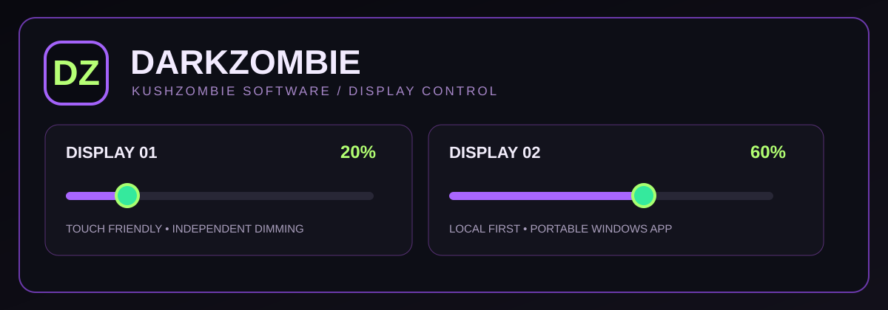

# DarkZombie Dimmer

**Portable Windows multi-monitor software dimmer** by KushZombie Software.

*Illustrative theme artwork, not a photograph of a user workstation.*

DarkZombie makes it simple to dim multiple displays separately without constantly adjusting each monitor's brightness controls. Designed for dark desktop setups, touchscreen use, and multi-monitor workstations.

## Download

**[Download DarkZombie v1.0.4 for Windows](downloads/DarkZombie_v1.0.4_Windows_Portable.zip)**

This is the **user-accepted v1.0.4 release**, not the later v1.0.5 visual-polish test candidate.

- **Platform:** Windows 10/11 x64
- **Requirements:** Windows PowerShell 5.1 and Windows .NET Framework/WPF (normally already present)
- **Installer:** None. Extract the ZIP and run `DarkZombie.exe`.
- **Internet or account:** Not required
- **Administrator permissions:** Not required

SHA-256 of ZIP: `9b440d93738f3b93a7553e88bc9030ce0860cfe7c5ddffd3f5aefd7964dbb758`

## Features

- Detect multiple connected displays, with individual **0–85% software dimming** sliders.
- Presets: **Clear** (0%), **Chill** (20%), **Night** (40%), **Zombie** (60%).
- Save and load favorite per-monitor levels.
- Touchscreen-friendly full-screen interface; **F11** switches between full-screen and windowed mode.
- Hide to the system tray; reopen, reset dimming, or exit from the tray.
- Create a desktop shortcut with the branded **DZ** icon.
- Automatic local settings retention.
- Includes `Emergency_Reset.cmd` to close DarkZombie and remove its overlays if needed.

## How it works and what it does not do

DarkZombie creates **click-through black overlays** on each monitor. It **does not** change the physical backlight brightness or provide hardware-level DDC/CI control. Exclusive-fullscreen games, HDR and protected-video pipelines may bypass the overlay.

It is an independent application, **not** a modification of or redistribution of the third-party Dimmer utility.

## Installation

1. Download the ZIP above.
2. Extract the **entire** ZIP to a folder you intend to keep.
3. Run `DarkZombie.exe` inside the extracted `DarkZombie_v1.0.4` folder.
4. Choose **Create Shortcut** in the application, or run `Create_Desktop_Shortcut.cmd`.

Keep `DarkZombie.exe` and `DarkZombie.ps1` together. Moving the extracted folder later may break an already-created desktop shortcut.

If something goes wrong, close DarkZombie through its tray icon or run `Emergency_Reset.cmd`. To uninstall, exit the app and delete the extracted folder. Settings are stored locally in `%LOCALAPPDATA%\DarkZombie\settings.json`.

## Source and credits

The main GUI and dimming logic are implemented in readable Windows PowerShell/WPF:

- [Main application source](source/DarkZombie.ps1)
- The portable ZIP also contains the launcher source and helper scripts for transparency.

**KushZombie:** Concept, design direction, functional requirements, Windows testing, and acceptance. Development used AI-assisted implementation and iteration.

**Status:** v1.0.4 was tested and accepted by the project owner. The public package is an unsigned portable Windows build, so Windows may warn about an unknown publisher. The archive has been inspected for bundled account/settings files; native Windows behavior on other hardware has not been independently verified.

Source is provided for transparency; no separate open-source redistribution license is granted by this repository.

[Back to the KushZombie portfolio](../../README.md)
