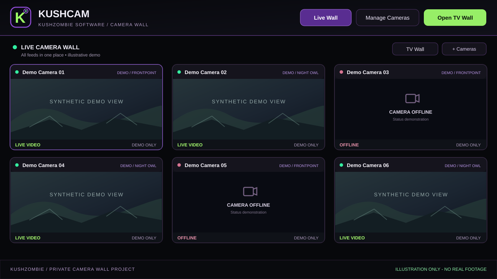

# KushCam

### Private multi-camera wall · Windows · Work in progress

KushCam is an independently developed Windows camera-wall application designed to bring **authorized Frontpoint/Alarm.com and Night Owl feeds** together in one locally hosted viewing interface.

*Illustrative interface artwork. All camera views and labels above are synthetic; this is not a screenshot of private surveillance footage.*

## What it does

- **Combined viewing:** Camera tiles from different supported security-camera systems in one interface.
- **Separate layouts:** Independently saved **TV Wall** and **Laptop View** layouts for different displays.
- **Interactive wall:** Add/remove/reorder camera tiles, pick different grid arrangements, and open a dedicated TV-wall view.
- **Status at a glance:** Shows live, reconnecting, and offline states instead of silently implying a frozen picture is live.
- **Recovery mechanisms:** Handles some dropped sessions and restarts with bounded retries; reliability is still affected by upstream camera services and connectivity.
- **KushZombie styling:** Dark interface with purple accents, green live indicators, and custom application branding.

## Actual project status

| Area | Status |
| --- | --- |
| MAIN Windows installation | **Working, user-accepted R15 baseline** |
| Laptop deployment | **All configured camera feeds verified on laptop (user-confirmed, November 12, 2026)**; continuous multi-camera uptime remains unverified |
| Long-term 24/7 reliability | **Not verified** |
| Doorbell integration | **Research paused**; no confirmed compatible live source |
| Public release or installer | **Not available** |
| Source repository | **Private**, pending a separate security and dependency review |

KushCam is a **personal, ongoing development project**, not a promise that any brand or camera model can be integrated or used continuously. Live-source compatibility depends on provider support, account access, device model, configuration, and network conditions.

## Privacy and release scope

This repository folder is a **public showcase only**. It intentionally contains **no** camera footage, account sessions, tokens, passwords, recorder configuration, camera identifiers, device IP addresses, WebRTC URLs, private network layout, or packaged runtimes. The public preview is synthetic.

The private application source and Windows builds are not published here because camera integrations, dependency licenses, and credential-handling paths require a separate release audit. This is not a download or setup guide.

## Development

**KushZombie:** Original project goals, creative direction, integration requirements, usability feedback, testing on multiple Windows computers, and acceptance decisions.

**Engineering workflow:** AI-assisted implementation, code review, and iterative debugging, including ChatGPT and Muse-assisted work, with user-led field testing. Individual prototype and build claims are documented separately and should not be confused with verified production operation.

[Return to the KushZombie portfolio](../../README.md) · [Aubum Local Node](https://github.com/kushzombie420/aubum-local-node)

---
*Status reviewed November 2026. No affiliation with, endorsement by, or official support from Frontpoint, Alarm.com, or Night Owl is implied.*
