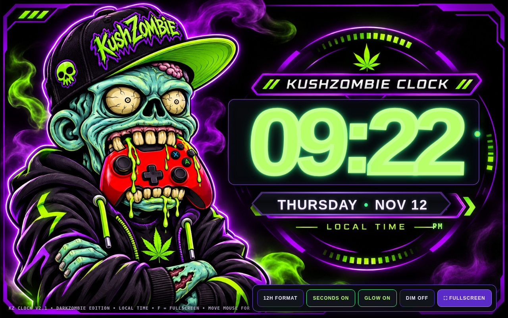

# KushZombie Clock · DarkZombie Edition

**An offline desktop clock for Windows browsers, styled in KushZombie's black, electric-purple, and zombie-green palette.**

*Screenshot captured from the real HTML clock running in Chromium. No real-world personal information is displayed.*

## Download

**[Download KushZombie Clock v2.1 DarkZombie Edition (portable ZIP)](downloads/KushZombie_Clock_v2.1_DarkZombie_Windows_Portable_TEST.zip)**

**Windows operation verified by the project owner on November 12, 2026:** the v2.1 clock is currently running on Windows. The HTML was also exercised in Chromium. The separate desktop-shortcut helper has not yet been independently confirmed.

- Extract the ZIP into a folder you intend to keep.
- Run `START_CLOCK.cmd` on Windows, or open `KushZombie_Clock_v2.1_DarkZombie.html` in a browser.
- To add a desktop icon, run `Create_Desktop_Shortcut.cmd` from the extracted folder. It creates a shortcut to the HTML file, not a native standalone .exe.
- The clock works offline and requires no account or server.

**ZIP SHA-256:** `05dd33b40f19b90c286bc3b9e085857e3011062321df57b906bfa2ff902d8c54`

## Features

- Live local time and date with optional seconds.
- 12/24-hour mode, fullscreen, brightness/dim and neon glow controls.
- Persistent browser preferences.
- DarkZombie-inspired charcoal background, purple accents and zombie-green highlights.
- Matching Windows `.ico` desktop logo.

## Verification and limits

**User-confirmed on Windows (November 12, 2026):** the owner reports actively using the v2.1 clock. Separately, the updated HTML passed Chromium interaction checks at desktop and portrait screen sizes, including hour-format, seconds, glow, and dim controls. The desktop-shortcut helper has **not** yet been explicitly verified, and compatibility with every Windows/browser configuration is not claimed.

The initial **v2 LIVE** HTML is retained separately in the user's private development archive and was not overwritten by this presentation refresh.

## Credits and privacy

**KushZombie:** Creative direction, concept, visual preferences and project testing. The app was developed iteratively with AI-assisted code and graphics. The published clock has no private account, camera or Aubum configuration data.

[Back to the KushZombie portfolio](../../README.md)
