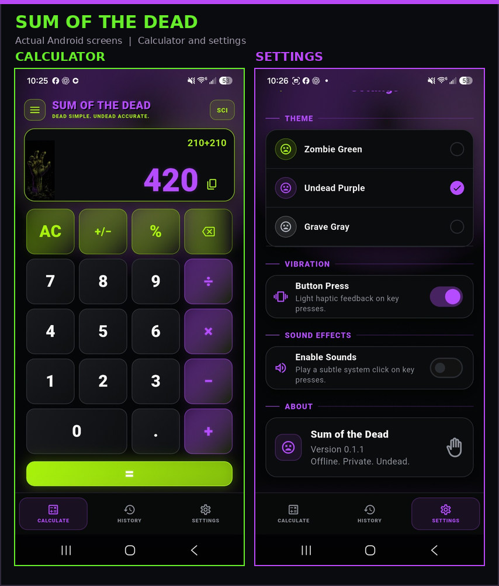

# Sum of the Dead

**Zombie-themed Android calculator · Flutter · Tested development build / internal-test project**

Sum of the Dead is a calculator app with a dark zombie-themed interface and green/purple visual styling. The project is separate from Cash Zombie, though possible future cross-app interaction has been discussed only as an idea.

*Screenshots from the owner's Android device, November 12, 2026. The calculator displays the example 210 + 210 = 420. The Settings screen identifies the installed app as Version 0.1.1.*

## Documented application

- A working standard calculator screen showing an example calculation of `210 + 210 = 420`, plus a visible copy-result icon and **SCI** control.
- **Calculate**, **History**, and **Settings** bottom navigation sections.
- Three visible theme selections: **Zombie Green**, **Undead Purple**, and **Grave Gray** (purple shown selected).
- Settings controls for **button-press vibration** (enabled in the screenshot) and **sound effects** (disabled in the screenshot).
- The Settings page reports **Version 0.1.1** and the tagline **Offline. Private. Undead.**

These are confirmed visible Android UI elements. Screenshots do **not** by themselves verify scientific calculations, the copy-result action, theme switching, haptic effects, sound playback, or landscape mode. The separate later v0.1.2+3 development checkpoint does not mean this photographed v0.1.1 installation was upgraded.

## Verified checkpoints

| Area | Evidence-based status |
| --- | --- |
| Preserved release baseline | **v0.1.1**, Android App Bundle built |
| Android App Bundle | **Built successfully** and protected in the private release archive |
| Play release candidate | **v0.1.1 / versionCode 2** reached the **Internal testing release flow** |
| Internal testing | Track and tester lists configured; **final publication/tester availability not conclusively verified** |
| Android compatibility shown in Play Console | Android API 24+; target SDK 36 |
| Later development checkpoint | **v0.1.2+3** passed Flutter analysis, unit tests, and an Android debug APK build on August 29, 2026; this does **not** establish a newer Play release |
| Public Google Play availability | **Not claimed** |

## Development boundaries

The v0.1.1 handoff documents arithmetic, history, settings, and layout checks as future release gates. A later v0.1.2+3 development checkpoint passed analysis, tests, and a debug APK build; broader UI acceptance or Play distribution of that version was not verified. Generated Flutter/Gradle caches were cleaned, but the private source and Android release bundle were preserved.

Potential integration with Cash Zombie is **an idea only**, not an implemented capability.

## Source, downloads, and privacy

**Public portfolio showcase only.** No app bundle, source tree, signing keystore, private Play service-account JSON, Google Play credentials, or user data are published here. No public download is offered until an approved build and its release rights/status are verified.

## Credits

**KushZombie:** App concept, visual direction, project decisions, and testing. AI-assisted Flutter development supported implementation and iteration.

[Return to the KushZombie portfolio](../../README.md)

*Status reflects retained August 2026 checkpoints; public showcase added November 2026.*
